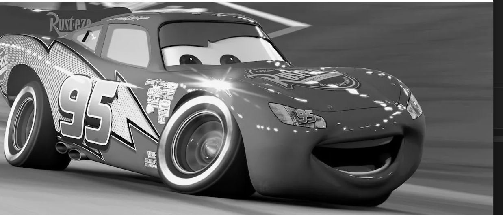
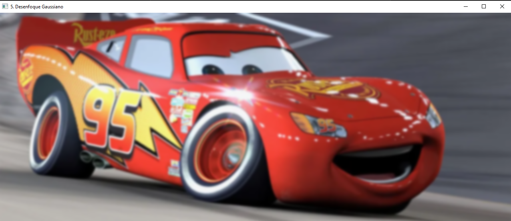
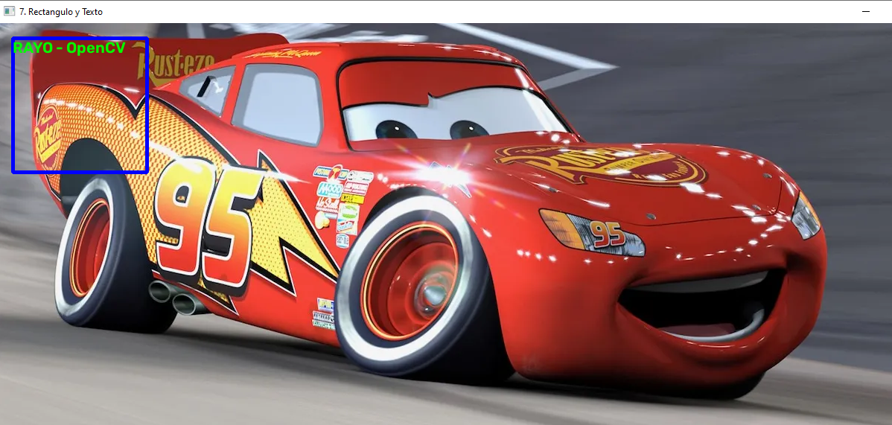
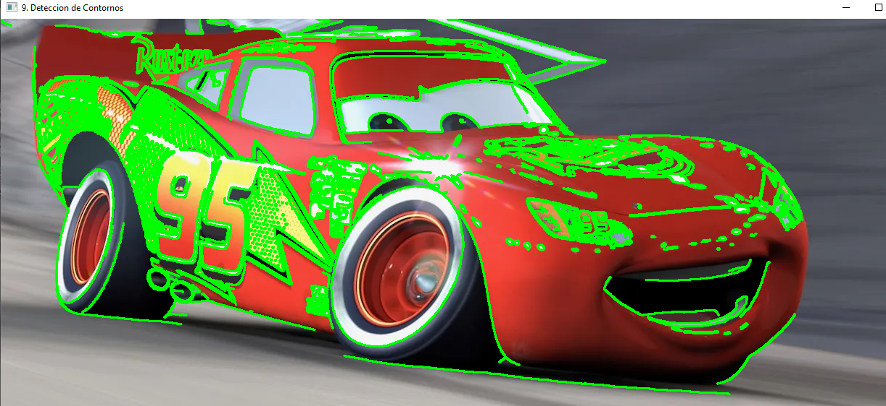

# Procesamiento de imágenes con OpenCV: una guía paso a paso # Iker Montoya NC 0105 

## imagen original 

# escala de grises 

## imagen redimencionada 

# imagen rotada 

## desenfoque gussaino 

## bordes cany 

# rectangulo y texto 

## umbralizacion 

## deteccion de contornos 

