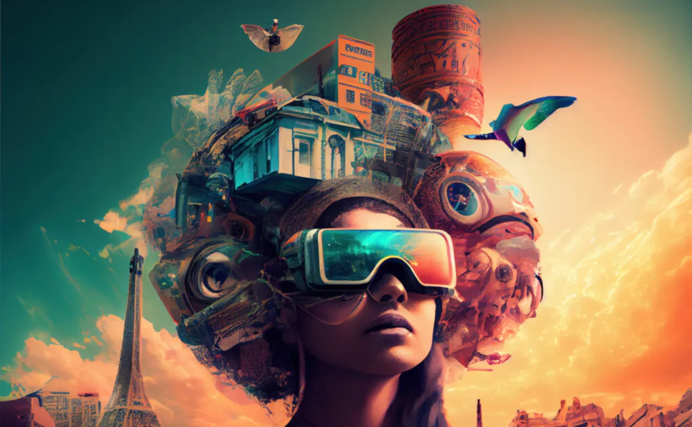
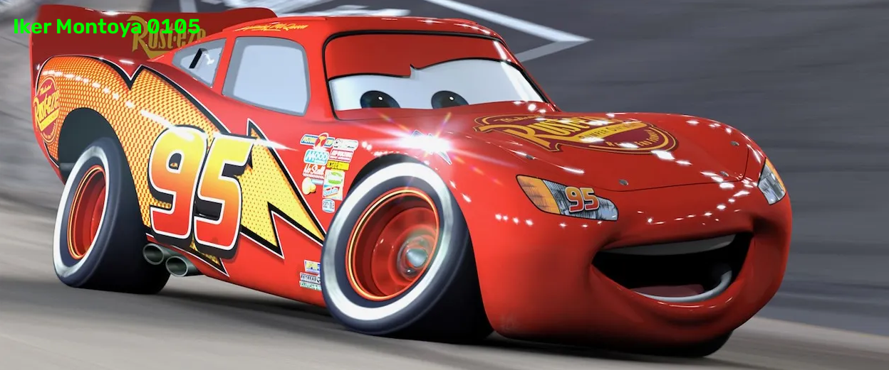
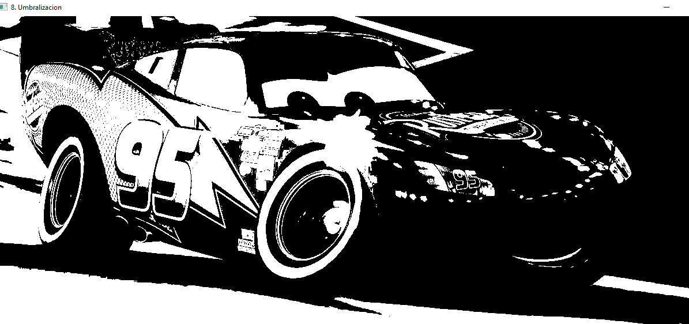
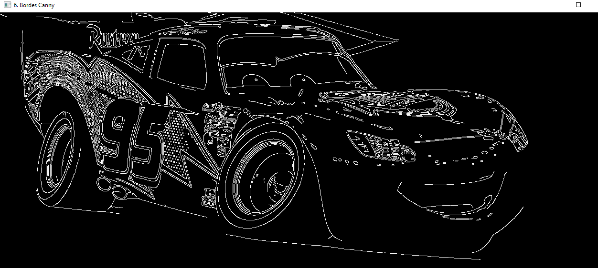
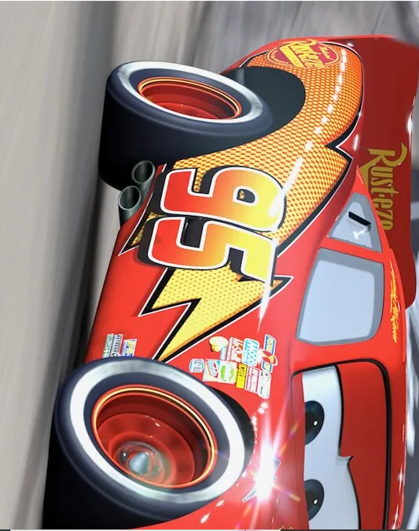
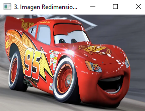

# Procesamiento de imágenes con OpenCV: una guía paso a paso # Iker Montoya NC 0105 

## imagen original 

## deteccion de contornos 

## umbralizacion 

# rectangulo y texto 

## bordes cany 

## desenfoque gussaino 

# imagen rotada 

## imagen redimencionada 

# escala de grises 

